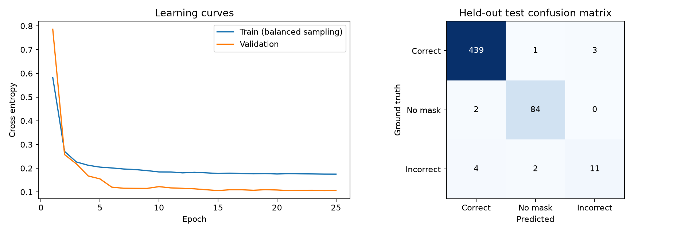
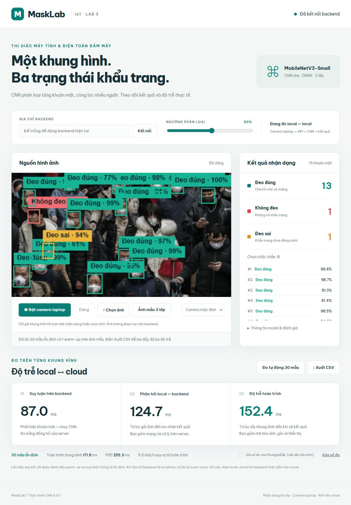
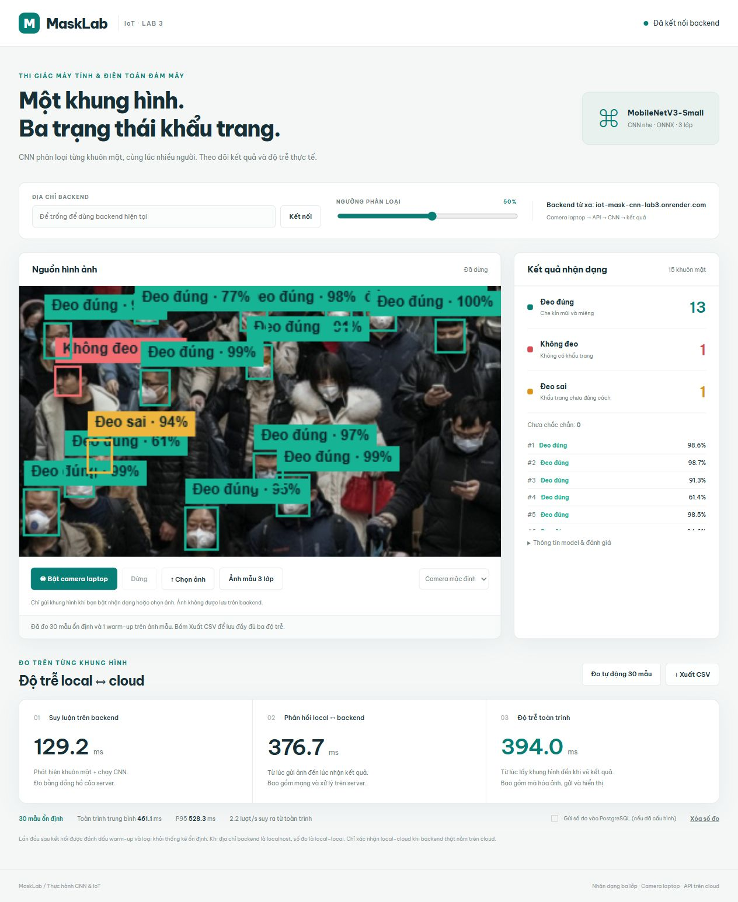
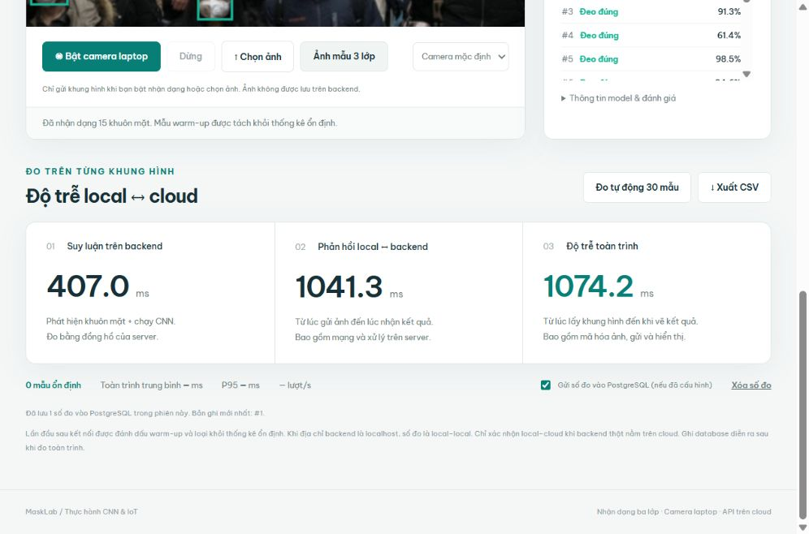

# Báo cáo Lab 3 — CNN nhận dạng ba trạng thái khẩu trang

## 1. Mục tiêu và kiến trúc

Phát hiện đồng thời nhiều khuôn mặt, phân loại đeo đúng, không đeo và đeo sai. Laptop lấy ảnh từ webcam, gửi JPEG qua HTTP(S) đến FastAPI. Server dùng CNN YuNet xác định các khuôn mặt, NMS loại khung trùng, crop có padding 10%, chuẩn hóa RGB và đưa vào cùng batch CNN MobileNetV3-Small. Server trả JSON, trình duyệt vẽ nhãn và đo độ trễ.

## 2. Dữ liệu và phương pháp

Số ảnh gốc hợp lệ: 851, số nhóm ảnh độc lập sau gom trùng: 836. Chia train/validation/test theo nhóm trước khi crop. Nhóm chứa ảnh RGB giống hệt hoặc dHash khác tối đa 4 bit. Bộ dữ liệu không có mã danh tính nên vẫn có khả năng cùng người xuất hiện ở các ảnh khác nhau.

| Lớp | Train | Validation | Test |
|---|---:|---:|---:|
| with_mask | 1935 | 416 | 443 |
| without_mask | 401 | 83 | 86 |
| mask_weared_incorrect | 81 | 17 | 17 |

Loại khuôn mặt có cạnh dưới 12 pixel. Augmentation chỉ ở train: lật ngang, affine nhẹ, thay đổi màu/độ sáng. WeightedRandomSampler cân bằng lớp đeo sai ít mẫu. Không tính các ảnh augmentation là mẫu gốc độc lập.

## 3. CNN và huấn luyện GPU

Kiến trúc: MobileNetV3-Small CNN, ImageNet transfer learning, 3-class head. Số tham số: 1,520,931. Đầu vào RGB 160×160, đầu ra 3 logits. Trọng số đầu vào pretrained ImageNet, fine-tune toàn bộ CNN.

Thiết bị thực train: **NVIDIA GeForce RTX 2050**. PyTorch 2.9.1+cu128, CUDA 12.8. Batch size 32, 25 epoch, seed 42. Tổng thời gian train và đánh giá: 1097.8 giây. Chọn checkpoint epoch 13 bằng validation macro F1, không dùng test chọn checkpoint.

Optimizer AdamW, LR ban đầu 0.0003, weight decay 0.001, cosine decay, cross entropy label smoothing 0.05. Mixed precision khi chạy CUDA.

## 4. Kết quả phân loại trên ảnh crop test

**Accuracy: 97.80%**. **Macro F1: 0.8898**. Đây là chất lượng CNN trên ảnh cắt bằng nhãn chuẩn, chưa gồm lỗi bộ phát hiện.

| Lớp | Precision | Recall | F1 | Support |
|---|---:|---:|---:|---:|
| with_mask | 0.9865 | 0.9910 | 0.9887 | 443 |
| without_mask | 0.9655 | 0.9767 | 0.9711 | 86 |
| mask_weared_incorrect | 0.7857 | 0.6471 | 0.7097 | 17 |

Confusion matrix theo thứ tự lớp: with_mask, without_mask, mask_weared_incorrect. Hàng = nhãn thật, cột = dự đoán.

```text
  439     1     3
    2    84     0
    4     2    11
```



Lớp đeo sai có ít mẫu test nên ước lượng Recall/F1 còn không chắc chắn. Tăng dữ liệu người thật/góc mặt/ánh sáng của lớp này trước khi sử dụng ngoài demo.

## 5. Xuất model một file

File `models/mask_detector.bundle`: 5.59 MiB. Chứa CNN ONNX, YuNet detector và metadata, backend nạp bằng một đường dẫn duy nhất. Đối chiếu PyTorch–ONNX trên batch thử, sai số tuyệt đối tối đa 0.00000106; kiểm tra batch động 1, 3 và 8 khuôn mặt.

SHA256: `e759400d377df9e3a8df9f4ea759fe645a3377411a580e7356acbba934e3b186`.

## 6. Đánh giá cả pipeline trên ảnh gốc test

Đã chạy trên 127 ảnh test gốc. Ghép dự đoán–ground truth bằng IoU ≥ 0,5. Detector precision 0.8606, detector recall 0.7802. Macro F1 cả pipeline 0.7562. Đây không phải mAP.

| Lớp | Precision pipeline | Recall pipeline | F1 pipeline |
|---|---:|---:|---:|
| with_mask | 0.9024 | 0.7517 | 0.8202 |
| without_mask | 0.6937 | 0.8953 | 0.7817 |
| mask_weared_incorrect | 0.9000 | 0.5294 | 0.6667 |

Số ảnh tự nhiên test được tìm thấy có dự đoán đúng ít nhất một khuôn mặt của cả ba lớp ở cùng một lần chạy: 3. Ảnh được chọn trình diễn không được dùng thay cho đánh giá toàn tập.

YuNet giữ tỉ lệ ảnh với cạnh dài 640 pixel, ngưỡng 0,7 được chọn qua validation. Pipeline được cải tiến sau khi xem kết quả SSD baseline trên tập test này, vì vậy số đo pipeline mang tính đánh giá kỹ thuật khám phá, không phải benchmark hoàn toàn độc lập. Việc chọn checkpoint CNN vẫn chỉ dùng validation; số đo crop classifier test được tách riêng.

## 7. Đo độ trễ và cloud

Giao diện đo suy luận server (YuNet detect + CNN run), RTT từ gửi ảnh đến đọc JSON và toàn trình từ lấy khung hình đến kết quả vẽ xong/chờ paint. Mẫu warm-up được gắn cờ riêng, mean/P95 chỉ tính mẫu ổn định. Đồng hồ server và trình duyệt tách biệt. Toàn trình không gồm thời gian cảm biến camera trước khi ứng dụng lấy frame.

Render Free chạy backend ONNX CPU, giao diện và file model đóng gói trong cùng Docker image. Camera là camera laptop của người truy cập trang. PostgreSQL là tùy chọn, không lưu ảnh.

Đã nghiệm thu bản cloud Live và thu CSV trình duyệt thật với đủ ba độ trễ. Xem số đo, URL và minh chứng tại mục 12; dữ liệu local được tách riêng.

## 8. Giới hạn và hướng cải thiện

Khuôn mặt nhỏ, nghiêng, thiếu sáng hoặc che khuất có thể bị YuNet bỏ sót; CNN không thể phân loại khuôn mặt chưa được phát hiện. Dữ liệu đeo sai ít và miền dữ liệu camera thực khác ảnh Internet. Ngưỡng confidence không phải thước đo độ chắc chắn đã hiệu chỉnh. Cloud miễn phí có cold start và giới hạn tài nguyên. Cần demo nhóm người thật đủ ba trạng thái để kiểm tra thêm.

## 9. Tài liệu tham khảo

Slide thầy cung cấp và bài báo Đàm Minh Lịnh và cộng sự (2023), DOI 10.54607/hcmue.js.20.11.3933(2023). Nguồn dữ liệu/model/tài liệu triển khai chi tiết trong [SOURCES.md](SOURCES.md). Kết quả ở báo cáo này được tạo từ artifact thực, không sao chép số liệu 99,94% của bài mẫu.

## 10. Kiểm tra triển khai local Docker

Đã đạt 17 kiểm tra, gồm ảnh nhóm thật nén JPEG chất lượng 88 với đủ ba lớp đúng theo IoU ≥ 0,5, batch 3/20 khuôn mặt, file model tải xuống và ảnh lỗi. Docker build thành công. Backend chạy với giới hạn 512 MiB RAM, đỉnh bộ nhớ đo được 162.7 MiB, không bị OOM.

Đo 30 lượt ổn định và 1 warm-up trên **local Docker**, ảnh mẫu có 15 khuôn mặt. Mỗi lượt đều trả về ít nhất một khuôn mặt thuộc cả ba lớp. Suy luận trung bình 64.05 ms (P95 87.87 ms); RTT trung bình 85.09 ms (P95 114.87 ms).

Các số trên là local Docker, chưa phải local–cloud. CLI không đo phần lấy ảnh/vẽ trên trình duyệt nên không gán số giả cho toàn trình. Phải dùng nút Đo tự động 30 mẫu hoặc camera trên giao diện cloud để lấy đủ ba độ trễ. Bản đo Docker này dùng ảnh mẫu, không đo khâu camera vật lý.

## 11. Kiểm tra giao diện và độ trễ toàn trình local

Đã chạy nút Đo tự động 30 mẫu trong trình duyệt trên ảnh nhóm công khai, gồm 1 warm-up và 30 mẫu ổn định. Cả 31 lần đều nhận dạng đủ ba lớp. Kiểm tra được hiển thị box, bộ đếm, ba số đo và nút xuất CSV. Đây là ảnh mẫu cố định, không phải webcam vật lý và không phải cloud.

| Số đo trình duyệt local | Trung bình (ms) | P95 (ms) |
|---|---:|---:|
| Suy luận backend | 104.14 | 158.04 |
| Phản hồi local–local | 148.26 | 227.30 |
| Toàn trình trình duyệt | 171.79 | 255.30 |

CSV gốc: `artifacts/browser_local_latency.csv`.



## 12. Triển khai và nghiệm thu cloud

Dịch vụ **Live** tại [https://iot-mask-cnn-lab3.onrender.com](https://iot-mask-cnn-lab3.onrender.com). Render Free, Singapore, Docker chạy ONNX CPU. Commit triển khai: `f41ad315379b11ce7ec9dc9775ead36c090b9ac6`. Đã gọi `/api/health` thành công và tải lại file model từ cloud; SHA256 khớp chính xác model train GPU: `e759400d377df9e3a8df9f4ea759fe645a3377411a580e7356acbba934e3b186`.

Camera laptop được xử lý ở trình duyệt của người xem, khung hình gửi tới API cloud. Không lưu ảnh camera trên backend. PostgreSQL lưu số đo khi người dùng chọn gửi; xem cấu hình và nghiệm thu tại mục 13.

Đã đo 30 mẫu ổn định và 1 warm-up từ trình duyệt trên laptop tới Render, trên ảnh nhóm cố định. Ngưỡng phân loại 0.50. Tab ứng dụng được chọn khi đo. Cả 31 lượt đều nhận dạng đủ ba lớp trong cùng khung hình.

| Local browser → Render | Trung bình (ms) | P95 (ms) |
|---|---:|---:|
| Suy luận cloud | 230.69 | 292.19 |
| Phản hồi local–cloud | 428.59 | 492.80 |
| Toàn trình trình duyệt | 461.07 | 528.30 |

CSV gốc: `artifacts/browser_cloud_latency.csv`. Ảnh minh chứng:



Thời gian toàn trình chịu ảnh hưởng của mã hóa JPEG, mạng, server và lịch vẽ trình duyệt. Giữ tab hiển thị khi đo. Có lưu một lượt đo chẩn đoán khi tab nằm nền tại `artifacts/browser_cloud_background_latency.csv`; không dùng lượt đó làm số đo tab ứng dụng phía trước. Các kết quả này dùng ảnh mẫu, chưa phải phép đo cảm biến camera hoặc nhóm người thật trên cloud.

Đã quan sát webcam laptop hoạt động trên giao diện local và nhận dạng một khuôn mặt. Không đưa ảnh camera riêng lên repository. Minh chứng ba lớp đồng thời trên cloud dùng ảnh nhóm công khai; buổi demo thực tế cần bố trí nhóm người đủ ba trạng thái trước camera.

## 13. PostgreSQL cloud

PostgreSQL 18 trên Render Free, Singapore; database `masklab`, service `masklab-measurements`. Gói miễn phí hết hạn 2026-11-25. Chặn kết nối Internet; backend dùng mạng nội bộ Render. Chuỗi kết nối chỉ nằm trong Environment của backend.

Đã thử từ giao diện cloud: bật gửi số đo, nhận dạng ảnh nhóm công khai với 15 khuôn mặt đủ ba lớp và ghi thành công bản ghi #1. API chỉ xác nhận thành công sau khi transaction commit. Bộ kiểm thử gồm ghi thật trên PostgreSQL Docker riêng và đọc lại bằng một kết nối khác; tổng 17 kiểm thử đạt.

Bảng `lab_measurements` lưu thời điểm UTC, UUID yêu cầu, SHA256 model, ba độ trễ và counts JSONB. Không lưu ảnh, video, dataset hay file model. Việc ghi database xảy ra sau thời điểm kết thúc đo toàn trình. Trạng thái kết nối được kiểm tra thật; lỗi ghi được báo riêng và CSV vẫn dùng được.

Minh chứng và hướng dẫn: [POSTGRESQL.md](POSTGRESQL.md), `artifacts/cloud_postgresql_verification.json`.


